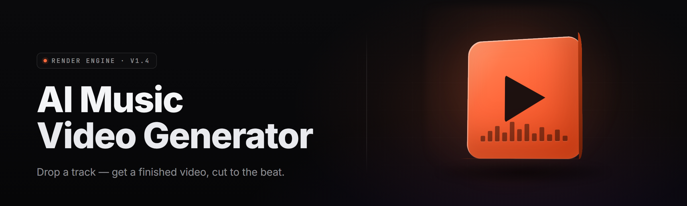

  
  
  

  

  
  

---

**Song → Visuals: turn any track into a finished music video.**

---

## 🎛️ Table of Contents

- [🎛️ Table of Contents](#-table-of-contents)
- [🎚️ Overview](#-overview)
- [🎤 What is Song → Visuals?](#-what-is-song--visuals)
- [🎬 The Problem](#-the-problem)
- [🧩 The Solution](#-the-solution)
- [📥 Download](#-download)
- [🖥️ Compatibility / Platform support](#️-compatibility--platform-support)
- [🚀 Quick Start](#-quick-start)
- [⚙️ System Requirements](#️-system-requirements)
- [🔑 Key Features](#-key-features)
- [📚 Grouped module catalog](#-grouped-module-catalog)
- [🎤 Vocal & lyric intelligence](#-vocal--lyric-intelligence)
- [🥁 Rhythm & beat synchronization](#-rhythm--beat-synchronization)
- [🎨 Visual generation core](#-visual-generation-core)
- [🎞️ Scene assembly & editing](#️-scene-assembly--editing)
- [🖌️ Style, grading & effects](#️-style-grading--effects)
- [📤 Export, render & delivery](#-export-render--delivery)
- [📋 All modules status](#-all-modules-status)
- [🎯 Tips for best results](#-tips-for-best-results)
- [🧰 Troubleshooting / Known Issues](#-troubleshooting--known-issues)
- [📝 Usage guidelines](#-usage-guidelines)
- [❔ FAQ](#-faq)

---

## 🎚️ Overview

**Song → Visuals** is a desktop AI music video generator for Windows. You drop a song in, it listens to the track the way a director would, and it cuts you a finished music video — shot by shot, on the beat, with a look that matches the mood. No timeline scrubbing, no stock footage bins, no render farm. One `.exe`, one audio file, one video out the other side.

| Category | Details |
|---|---|
| **Product** | AI music video generator (song → visuals) |
| **Release** | v2.6.1 · 2026 |
| **Format** | Portable Windows `.exe` — no installer, extract and run |
| **Input** | `.wav`, `.mp3`, `.flac`, `.m4a`, `.ogg` (mono or stereo, up to 24-bit/96 kHz) |
| **Output** | MP4 (H.264/H.265), WebM, ProRes, PNG sequence |
| **Engine** | Local diffusion + beat-tracking + lyric alignment, GPU-accelerated |
| **Core idea** | The song is the edit. The AI is the editor. |

---

## 🎤 What is Song → Visuals?

An AI music video generator reads a song, understands its structure — verses, drops, bridges, choruses, vocal phrases — and produces a video whose cuts, motion, color, and imagery are all locked to that structure. It is not a slideshow tool. It is not a lyrics-on-screen karaoke app. It builds shot lists, generates footage, aligns them to musical events, and renders one continuous cut.

| Term | Explanation |
|---|---|
| **Beat grid** | The detected timing of every beat, downbeat, and bar in the track — the spine every cut hangs off. |
| **Stem** | An isolated element of the mix — vocals, drums, bass, melody — pulled apart so each can drive its own visual layer. |
| **Shot** | A single generated visual unit (2–6 s) with a defined motion, subject, and grade, placed on the timeline. |
| **Beat-sync cut** | A cut placed exactly on a beat or downbeat, not on an arbitrary frame timestamp. |
| **Motion prompt** | The natural-language instruction that tells the generator how a shot should move (push in, drift, orbit, snap). |
| **Style key** | A saved look (color palette, grain, grade, lens feel) reused across a whole video for consistency. |
| **Render pass** | One trip through the pipeline: decode → analyze → generate → edit → encode. |

**Why it lands:**

- The song drives everything — cuts, motion, palette, pacing — so the video never fights the music.
- Lyric-aware: on-screen text and scene changes can follow line-by-line or word-by-word.
- Consistent look across every shot via style keys, so it reads as one video, not a shuffled deck.
- Runs locally on your GPU — your tracks and your renders stay on your machine.
- Scene-by-scene editing after generation — regenerate any single shot without redoing the video.

---

## 🎬 The Problem

Generating a music video usually means one of three painful paths, and all of them waste the artist's time:

- **Manual editors cost days.** Cutting a 3-minute track to beats by hand is a full work session before a single frame is generated.
- **Stock libraries look stock.** The same drone shots and light-leak overlays on every channel — nobody mistakes it for intentional.
- **Generic AI video tools ignore the music.** They generate pretty clips that drift out of sync, land cuts on the wrong beat, and change visual style every two seconds.
- **Lyric sync is a nightmare.** Timing text to phrasing, holding a line long enough to read, clearing it before the next — nobody does this by hand for a 40-line track.
- **Consistency collapses.** Re-rolling a shot until it matches the others is guesswork when the tool has no memory of the look you locked in.
- **Rendering eats your machine.** Cloud tools queue you for hours; local tools choke the GPU and crash before the last chorus.
- **Export options are rigid.** You need ProRes for a client and MP4 for Instagram — most tools give you one and call it a day.

---

## 🧩 The Solution

| Problem | Solution |
|---|---|
| Manual editing costs days | Automatic beat-grid detection + beat-sync auto-cut — the edit is built before you touch it |
| Stock libraries look stale | Local diffusion generation — every shot is unique to your track |
| Generic AI ignores music | Rhythm engine drives cut timing, motion intensity, and pacing from the actual waveform |
| Lyric sync by hand | Forced-align lyric-to-audio and auto text overlays timed to vocal phrases |
| Style collapse across shots | Style keys lock palette, grain, grade, and lens feel across every shot |
| Slow / expensive cloud render | Fully local GPU pipeline with tiled generation and async encode |
| Rigid export | Six presets (H.264, H.265, WebM, ProRes, GIF, PNG sequence) at any resolution up to 4K |

---

## 📥 Download

Grab the portable build from the project landing page. Extract the folder, run the `.exe`, and you're rendering within minutes. No install wizard, no dependency hunting, no account.

  

---

## 🖥️ Compatibility / Platform support

| Platform | Status | Notes |
|---|---|---|
| Windows 11 x64 | ✅ Full | Primary target; DX12 GPU path recommended |
| Windows 10 22H2 x64 | ✅ Full | Requires latest GPU drivers |
| NVIDIA RTX 30/40/50 | ✅ Full | CUDA path; fastest generation times |
| AMD RX 6000/7000 | ✅ Full | DirectML path; slightly slower per-shot |
| Intel Arc A-series | ⚠️ Partial | DirectML works; some LoRA layers fall back to CPU |
| macOS (Apple Silicon) | 🚧 Planned | Metal build on roadmap, not in this release |
| Linux (Proton) | ⚠️ Experimental | Runs, but GPU accel needs manual setup |

---

## 🚀 Quick Start

1. 🎧 **Download & extract** the portable folder from the project page. Keep the folder structure intact.
2. ▶️ **Run the `.exe`** — first launch does a one-time GPU probe and packs the starter model set.
3. 🎵 **Drop your song** onto the timeline panel, or hit *Import Track* and pick a file.
4. ✍️ **Paste lyrics** (optional) into the lyrics panel — the aligner times them automatically.
5. 🎬 **Pick a style key**, hit *Generate*, and watch the shot list build. Tweak any shot, then render.

---

## ⚙️ System Requirements

| Component | Minimum | Recommended |
|---|---|---|
| OS | Windows 10 22H2 x64 | Windows 11 23H2+ x64 |
| CPU | 6-core (Ryzen 5 3600 / i5-10400) | 8–16 core (Ryzen 7 7700X / i7-13700K) |
| RAM | 16 GB | 32 GB |
| GPU | 8 GB VRAM (RTX 3060 / RX 6600) | 12–24 GB VRAM (RTX 4070 Ti / 4090) |
| Storage | 25 GB free (SSD) | 80 GB NVMe SSD |
| DirectX | DX12 | DX12 Ultimate |
| Driver | Recent CUDA 12+ / Adrenalin 23+ | Latest studio drivers |

---

## 🔑 Key Features

| Feature | Description | Benefit |
|---|---|---|
| **Beat-grid auto-cut** | Detects beats/downbeats and places cuts on the grid | Video locks to the groove automatically |
| **Stem separation** | Splits the mix into vocals / drums / bass / melodic layers | Each instrument can drive its own visual layer |
| **Style keys** | Saved look presets — palette, grade, grain, lens | Consistent visual identity across every shot |
| **Shot timeline** | Full cut list with per-shot regenerate, reorder, and trim | Fix one shot without redrawing the whole video |
| **Lyric aligner** | Forced alignment times each line to the vocal | Lyric videos and karaoke cuts in seconds |
| **Motion prompts** | Direct motion per shot (push, orbit, drift, snap) | Shot motion feels intentional, not random |
| **Song-structure map** | Verse/chorus/bridge/drop detection | Energy ramps where the music actually ramps |
| **Local generation** | All diffusion on your own GPU | No queue, no upload, no per-render cost |
| **Multi-preset export** | MP4, H.265, WebM, ProRes, GIF, PNG sequence | One render, every delivery format |
| **Queue manager** | Batch multiple tracks back-to-back | Render a whole EP overnight |
| **Preview scrub** | Low-res fast preview before full render | Sanity-check the edit in seconds |
| **Project files** | Save/load `.s2v` project bundles | Resume editing days later |

---

## 📚 Grouped module catalog

Fifty-plus modules sit in six families. Each family owns one job in the pipeline, from raw audio in to finished video out.

### 🎤 Vocal & lyric intelligence

- **Vocal Stem Isolator** — pulls the lead vocal from the mix; feeds every lyric-alignment downstream step.
- **Phrase Boundary Detector** — finds start/end of each vocal phrase so overlays don't linger past the line.
- **Lyric Aligner (forced alignment)** — maps pasted lyrics to the timing of the vocal, word by word.
- **Lyric Language Router** — detects language, routes to the right phoneme model.
- **Ad-lib & Backing Tagger** — flags call-outs and backing lines so they get a lighter visual treatment.
- **Section-Aware Text Placement** — positions overlays to avoid subject matter (faces, focal points).
- **Karaoke Cue Export** — emits SRT/VTT timed to the lyric for karaoke or client hand-off.

### 🥁 Rhythm & beat synchronization

- **Onset Detector** — sample-accurate transients across the full mix.
- **Beat & Downbeat Tracker** — grid estimation with tempo drift correction.
- **Bar & Phrase Segmenter** — bars grouped into 2/4/8-bar phrases.
- **Drop Detector** — finds build-ups and drops for motion and grade ramps.
- **BPM Lock Engine** — every cut timing quantizes to the detected BPM.
- **Stem-Driven Cut Ranker** — prioritizes cuts on drum hits, secondary on melody pulses.
- **Energy Curve Extractor** — RMS/spectral energy curve that drives motion and edit intensity.

### 🎨 Visual generation core

- **Diffusion Backbone (SDXL-class)** — the base generator producing the raw frames.
- **LoRA Slot Manager** — loadable style sub-models: filmic, anime, animatic, halftone, etc.
- **Prompt Composer** — merges user prompt, style key, and shot intent into one prompt.
- **Seed Planner** — deterministic seed scheduling so shots recur in families, not randomly.
- **Aspect & Framing Presets** — 16:9, 9:16, 1:1, 4:5, cinematic bars, ultrawide.
- **Latent Tiler** — tiled latent refinement for 4K generation on 12 GB cards.
- **Refiner Pass** — second-stage sharpening for faces, text, and fine texture.

### 🎞️ Scene assembly & editing

- **Shot Composer** — assembles shots into an ordered cut list with durations.
- **Beat-Sync Auto-Cut** — places cuts on beats/downbeats, honors drop ramps.
- **Transition Library** — cut, dissolve, whip-pan, match-cut, hard-flash, glitch.
- **Speed Curve Tool** — per-shot time remap for ramps and jerks.
- **Cross-Shot Motif Tracker** — keeps recurring subjects (a face, a car, a color) onscreen in families.
- **Timeline Mixer** — combine generated shots with imported clips.
- **Marker & Chapter Writer** — scenes cut to verse/chorus boundaries for the output file.

### 🖌️ Style, grading & effects

- **Style Key Manager** — save/apply named looks; every shot inherits them.
- **Auto Grader** — color match across shots so they read as one photo department.
- **Film Emulation Stack** — grain, halation, gate weave, chromatic edges.
- **Lens Simulator** — anamorphic flare, barrel distortion, focus falloff.
- **Beat-Driven Bloom** — bloom pulses on the beat, scaled by curve energy.
- **Motion Blur Pass** — per-shot synthetic motion blur for realistic movement.
- **Text Effect Bank** — outlines, masks, karaoke reveals, typewriter, neon.

### 📤 Export, render & delivery

- **Encoder Bridge** — FFmpeg-based H.264/H.265/WebM/ProRes export.
- **Frame Buffer Manager** — async decode → generate → encode without stalls.
- **Render Queue** — batch jobs overnight, failure recoverable.
- **Preview Scrub Server** — streams low-res preview to the timeline.
- **Metadata Writer** — track title, artist, BPM, style, duration stamped.
- **Preset Migrator** — import style keys and settings between versions.
- **Render Reporter** — per-shot and total time, GPU peak, VRAM headroom.
- **Portable Project Bundle** — `.s2v` file holds timeline, shots, style keys, lyrics.

---

## 📋 All modules status

| Module | Status | Description |
|---|---|---|
| Beat & Downbeat Tracker | ✅ Working | Full-mix beat grid with drift correction |
| Vocal Stem Isolator | ✅ Working | Lead vocal extraction for lyric sync |
| Lyric Aligner | ✅ Working | Forced alignment to vocal phrases |
| Style Key Manager | ✅ Working | Save/apply palettes + grades across shots |
| Diffusion Backbone | ✅ Working | Base image generator, SDXL-class |
| Latent Tiler (4K) | ✅ Working | Tiled refinement for high res on 12GB |
| Beat-Sync Auto-Cut | ✅ Working | Cuts snapped to beat grid |
| Transition Library | ✅ Working | Cut / dissolve / whip / glitch |
| Auto Grader | ✅ Working | Cross-shot color match |
| Encoder Bridge | ✅ Working | H.264/H.265/WebM/ProRes export |
| Render Queue | ✅ Working | Batch overnight rendering with retry |
| Motion Prompt Engine | ✅ Working | Per-shot motion controls |
| LoRA Slot Manager | ✅ Working | Loadable style sub-models |
| Intel Arc full accel | ⚠️ Partial | Some LoRA layers fall back to CPU |
| macOS Metal build | 🚧 Planned | Not in this release |
| Cloud render offload | 🚧 Planned | Opt-in, on roadmap |

---

## 🎯 Tips for best results

- Feed it a clean, uncompressed track when you can — WAV or FLAC beats a streamed MP3.
- Paste lyrics **before** generating; the aligner builds better shots when it knows the phrasing.
- Lock a **style key first**, then generate. Style before shots is a cheat code for consistency.
- Keep shot count proportional to song length — roughly one shot per 4–6 seconds reads as a cut, not a slideshow.
- For a vertical short, start from a 9:16 preset and let the auto-framing keep subjects centered.
- When a shot misbehaves, regenerate just that shot with the same seed plus a prompt tweak — the rest of the cut stays untouched.
- Use the drop detector output in your grade ramp so the transition into a drop is visible, not just audible.
- Render at 1080p for review, then bump to 4K once the cut is locked — saves hours.

---

## 🧰 Troubleshooting / Known Issues

| Issue | Fix |
|---|---|
| First launch slow on cold GPU | One-time model warmup — subsequent launches are fast. Give it a couple of minutes. |
| "VRAM exceeded" during render | Lower output resolution one step, or enable **Latent Tiler**. Don't stack LoRAs beyond 2 on 8 GB cards. |
| Lyrics drift out of sync on ad-libs | Exclude ad-lib lines from alignment, or tag them in the backup `adlib:` block. |
| AMD breaks after driver update | Roll back to a recent Adrenalin, or switch GPU path to DirectML-fallback in settings. |
| Audio pops on import | Convert to 44.1 kHz / 48 kHz 16-bit or 24-bit before importing. Sample-rate mismatches are the usual cause. |
| Export stalls at 99% | A stopped encoder process can hold the file. Close the app from the tray, delete the `.tmp` render, retry. |

---

## 📝 Usage guidelines

**Allowed**

- Music videos for your own or your clients' tracks.
- Lyric videos, karaoke cuts, teasers, and visualizers for distribution.
- Personal and commercial use of rendered output, within your local laws.
- Exporting ProRes and handing it to another editor for finishing.

**Not allowed**

- Generating content that depicts real identifiable people in compromising or false scenarios.
- Using the tool to produce illegal content under your jurisdiction's law.
- Redistributing bundled model weights outside the terms set by their original licenses.
- Passing off AI-generated footage as genuine photographed reality in contexts where that matters (news, evidence, advertising claims).

> Licensing of *this* repository is MIT. Bundled model weights carry their own licenses; keep them paired with their attribution notices.

---

## ❔ FAQ

**Q:** Is this free?

**A:** The tool is free and open source. Your GPU does the work, your machine does the render — no cloud bill, no per-minute charge.

**Q:** Does it need internet after install?

**A:** No. Models are packed locally. You can run fully offline after the first launch.

**Q:** Can I generate vertical shorts for TikTok and Reels?

**A:** Yes. Pick a 9:16 aspect preset, and the auto-framing keeps subjects framed for vertical.

**Q:** How long does a render take?

**A:** On a 12 GB RTX card, roughly 1.5–4 minutes per minute of finished video at 1080p, depending on style key and refiner passes.

**Q:** Can I get the edit as an editable timeline?

**A:** Yes — the tool can export a cut list and an EDL, plus marker/chapter data, so another editor can pick up where it left off.

**Q:** Will it work with my existing instrumentals?

**A:** Absolutely. Skip the lyric panel and it will cut purely to the beat grid and energy curve.

**Q:** Does it detect key changes and tempo shifts?

**A:** Yes — the beat tracker includes drift correction and the section segmenter flags key changes as scene cues.

**Q:** Can I import my own footage instead of generating?

**A:** Yes. The timeline mixer accepts imported clips alongside generated shots, with the same beat-sync cut logic.

**Q:** Do I need a GPU?

**A:** A GPU with 8 GB VRAM is the floor; the tool will run a CPU fallback but at a fraction of the speed.

---

If you've ever wanted your track to *look* the way it sounds, this is the shortest road from one to the other. Drop the song, paste the lyrics if you've got them, pick a look, and let the engine build a cut you'd be proud to ship. It renders on your machine, it edits to the music, and it stops the moment you're happy.

  

